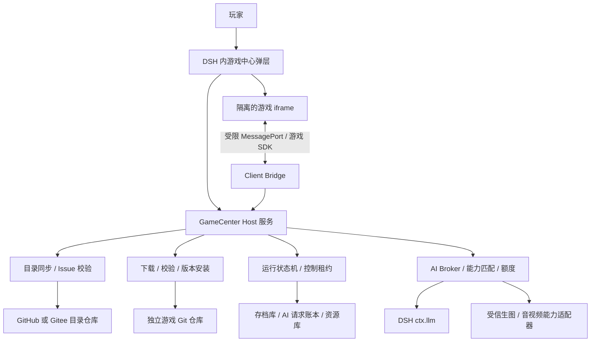
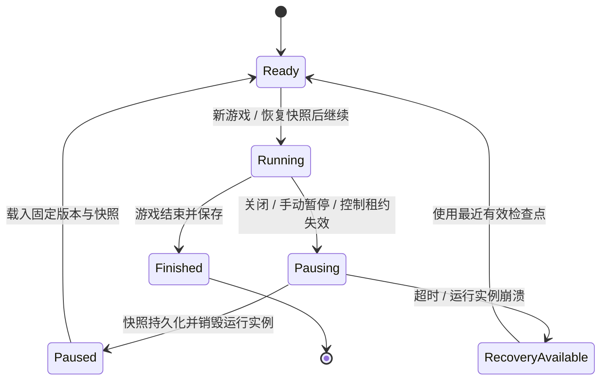

# DSH 游戏中心实现方案

设计日期：2026-10-18。本文是实现设计，尚未创建可运行插件。

建议将产品定位为：**DSH 内的小游戏平台，初期使用 GitHub Issue 作为游戏目录，以独立 GitHub 仓库分发游戏，由游戏中心统一提供模型、存档和生命周期服务。**

范围修订（用户于2026-10-19确认）：**先期开发与首版验收仅支持 GitHub，Gitee 仓库支持延至后续扩展，不是首版阻断项。** 本文其余 GitHub/Gitee 并列描述仅保留为后续多平台架构说明，不代表当前支持或开发承诺。初期目录同步、下载源及发布工具仅启用 GitHub；可保留 `forge` 身份字段和 `CatalogProvider` 边界，但不为 Gitee 预先实现或测试。

首版默认运行环境是用户电脑上的 DSH Desktop，或在同一台电脑启动的 DSH Web Host。首版游戏类型限定为遵循平台 SDK 的 HTML / JavaScript / WebAssembly 小游戏，可使用 Canvas、Phaser、PixiJS 等引擎。Unity / Godot 导出的 Web 游戏可以后续接入，但同样必须实现存档与恢复协议。原生可执行文件和任意 Node / Python 项目不属于首版运行协议。

如果 DSH Host 部署在远程服务器，下载位置就是服务器；要下载到玩家电脑，需要另做本地伴随进程。不能把远程 Host 上的安装称为客户端本地安装。

## 1. 已核实的 DSH 接入基础

参考官方仓库提交：`687f282e8625c6b8d11ff58211a90524be2e4317`。开发时需锁定实际验证通过的 DSH 版本，不能以不断变化的 master 作为兼容承诺。

| 能力 | 调研结论 | 游戏中心如何使用 |
| --- | --- | --- |
| 插件组织 | Host 与浏览器 Client 都基于 Cordis 插件组织 | 游戏中心分别提供 Host 和 Client 入口 |
| UI 扩展 | 有 Slots、`shell.overlay`、共享 `Modal` | 注册入口，在 DSH 窗口内部展示游戏中心弹层 |
| Host 调用 | Typert Remote 支持类型化方法、流和取消 | 暴露游戏目录、安装、存档和 AI 请求服务 |
| 模型目录 | `ctx.llm.listProviders()`、`listModels(provider)`、`resolveModelInfo(provider, model)` | 后端生成脱敏的可用模型目录 |
| 模型调用 | `ctx.llm.stream(...)` 是已注册 LLM provider 的统一调用路径 | 后端 AI Broker 调用，游戏不接触 provider 凭据 |
| 模态元数据 | 核心 `ModelModalityMap` 内置 `text` / `image`，可扩展；有输入模态描述 | 可以利用文本与图片输入信息，但能力未知时不能默认为支持 |
| 生图与音视频 | 本次查看的核心契约不足以证明通用生图、音频和视频生成接口已存在 | 由独立能力适配器补齐，不伪装成已有 DSH 核心接口 |

第三方 Remote 的 `/remote` contribution 需要进入 Client 的显式装配；不能认为写上 `@Remote` 就会自动出现在所有 DSH Client 中。第一个开发检查点应验证外部插件的 Host/Client 加载、Remote contribution 挂载和弹层注册。如果目标发行版缺少必要扩展入口，需要明确最小上游扩展点或收窄支持版本。

本文中的 `GameCenterService`、`gamecenter.*` SDK、模型 slot 和能力注册表都是拟新增协议，不是 DSH 已有 API。

## 2. 参与角色与交付责任

这些是职责划分，不要求配备同等数量的人员，也不要求每个角色都由 AI Agent 承担。

| 角色 | 主要职责 | 需要的能力 | 交付物或权限 |
| --- | --- | --- | --- |
| 玩家 | 绑定目录仓库、安装游戏、选择模型、游玩和恢复进度 | 基本 Git 仓库与模型配置概念；不需要编程 | 本机游戏库、存档、模型绑定；可以设定请求额度 |
| 游戏开发者 | 编写玩法、接入 SDK、声明模型需求、实现暂停/序列化/恢复 | TypeScript / Web 游戏开发、状态管理、JSON Schema、异步取消 | 游戏仓库、`gamecenter.json`、可运行 `dist/`、状态迁移逻辑 |
| 游戏目录维护者 | 审核上架、校验发布来源、维护可信版本、处理下架 | GitHub/Gitee Issue 管理、发布审核、版本与摘要校验 | 管理目录仓库和上架审批；不能访问玩家凭据或存档 |
| 游戏中心维护者 | 实现 DSH 插件、安装器、运行时、存档与兼容层 | Cordis / DSH、TypeScript、React、进程与文件边界、持久化 | 插件包、SDK、兼容矩阵、故障恢复机制 |
| 模型适配器开发者 | 将 DSH 或受信插件能力映射成统一的文本/视觉/生图等接口 | 流式 API、凭据引用、能力建模、取消与限流 | 能力适配器、模型能力证据、稳定错误码 |

实际开发可划分为架构与协议、DSH Host 接入、界面与游戏运行时、模型接入、目录与安装、测试与发布六项工作。小团队可以合并岗位，但协议负责人应统一维护 manifest、SDK 与存档版本。

## 3. 运行模块与边界



| 系统模块 | 职责 | 必要能力 |
| --- | --- | --- |
| GameCenter UI | 游戏列表、详情、下载进度、模型选择、继续游戏 | DSH Slots、React、Modal、可访问交互 |
| Catalog Service | 同步 Issue、解析固定格式、筛选可信发布、缓存 | GitHub/Gitee API、分页、速率限制、增量同步、Schema 校验 |
| Package Manager | 获取指定提交、校验产物、安装、升级和回滚 | Git/归档下载、不可变版本、路径检查、原子安装 |
| Runtime Supervisor | 启动游戏、控制输入/时钟/音频、关闭即暂停 | iframe 隔离、MessagePort、生命周期协议、超时与控制租约 |
| AI Broker | 匹配模型、执行请求、管理取消/额度/输出 | DSH LLM、能力适配、流处理、请求账本、响应格式验证 |
| Save Store | 保存游戏状态、模型绑定、生成资源、恢复与迁移 | SQLite 事务、文件资源管理、版本迁移、完整性校验 |
| DSH Adapter | 屏蔽目标 DSH 版本差异 | 插件加载、Remote 装配、模型与凭据接口、兼容测试 |

Host 负责权威状态和持久化，Client 负责展示和输入，小游戏只通过 SDK 使用授权能力。模型生成的游戏内容不会自动变成具有 DSH 工具权限的 Agent；需要工具型玩法时，应另外设计受限能力集合。

## 4. 双仓库结构与发布流程

目录仓库保存游戏介绍和可校验的下载指向；游戏仓库保存代码、运行产物与机器可读 manifest。

```text
game-catalog                         # GitHub 或 Gitee 目录仓库
  Issues                            # 每个游戏一个条目，正文由发布工具生成
  approvals/                        # 维护者审核的发布摘要记录
  schemas/catalog-entry.v1.json

ai-detective                        # 一个独立游戏仓库
  gamecenter.json                   # 运行契约的来源
  src/
  dist/index.html                  # 玩家下载后可直接运行
  dist/assets/
  README.md
```

建议每个游戏保留一个稳定 Issue；新版本更新同一条目的发布元数据，同时保留已审批版本记录。游戏身份使用稳定 `gameId`，本地来源键使用 `{forge, owner, repo, issueId}`，不依赖 Issue 标题，也不假设 Gitee Issue 标识一定是 GitHub 式数字。

发布顺序：

1. 开发者在游戏仓库编写并验证 `gamecenter.json`，生成并提交 `dist/`。
2. 创建发布提交，发布工具读取该不可变提交，计算 manifest 和产物摘要。
3. 发布工具生成 Issue 的人类介绍和唯一机器数据块。
4. 目录维护者审核该提交与摘要，并通过保护分支上的审批记录或等效签名批准。
5. 游戏中心同步 Issue，校验其发布元组与可信审批记录一致后允许安装。

Issue 是可变的发现索引，不能单独作为信任根。标签可以表示待审核/已上架，但已批准的 `{gameId, repository, commit, manifestDigest, bundleDigest}` 才决定某个版本是否可安装。Issue 被编辑为另一个提交或下载链接后，旧审批不会自动覆盖新内容。首版可要求只有维护者能够维护上架 Issue，并保留受保护的审批记录；后续支持作者自助提交。

### 4.1 固定 Issue 格式

下面使用 `example` 命名空间和占位摘要，仅说明协议，不是实际可安装条目。

````markdown
<!-- dsh-gamecenter-entry:v1 -->
# AI 侦探社

与 AI 角色对话，调查线索并解开案件。

```gamecenter-json
{
  "schemaVersion": 1,
  "gameId": "example.ai-detective",
  "title": "AI 侦探社",
  "summary": "与 AI 角色对话，调查线索并解开案件。",
  "version": "1.0.0",
  "source": {
    "repository": "https://github.com/example/ai-detective.git",
    "ref": "v1.0.0",
    "commit": "<完整提交 SHA>"
  },
  "manifestPath": "gamecenter.json",
  "manifestDigest": "sha256:<manifest 文件字节摘要>",
  "bundleDigest": "sha256:<dist 文件清单与内容的规范摘要>"
}
```
````

解析规则：只读取一个指定机器块；拒绝重复块、重复 JSON key、超限正文与未知主版本。描述文字只作展示，不能被解释为安装命令。`ref` 供人识别，实际下载以完整提交为准。Issue 中展示的模型标签由固定提交中的 manifest 生成，安装时仍须再次校验。

GitHub 和 Gitee 分别实现 `CatalogProvider`，统一输出条目、来源身份、更新时间、分页游标和缓存校验信息；不要假设两家有相同的分页、权限或条件请求机制。适配器负责各自的 token 与限流语义。GitHub 的 Issues 列表可能包含 PR，必须排除带 `pull_request` 字段的记录。

刷新发生在打开中心、手动刷新和可配置缓存过期时；离线使用上次成功目录。同步异常不抹掉缓存。增量同步需要重叠时间窗口并定期完整对账，以发现关闭、删除和取消上架的条目。Webhook 可后续增加。

## 5. 游戏 manifest 与模型能力

`gamecenter.json` 是固定提交内的运行契约。发布工具从它生成 Issue 摘要，避免维护两份互相冲突的运行配置。

```json
{
  "schemaVersion": 1,
  "id": "example.ai-detective",
  "name": "AI 侦探社",
  "version": "1.0.0",
  "sdk": "^1.0.0",
  "runtime": {
    "kind": "web",
    "entry": "dist/index.html"
  },
  "save": {
    "schemaVersion": 1,
    "supportsResume": true,
    "checkpointPolicy": "each-action"
  },
  "permissions": {
    "storage": "game-scoped",
    "directNetwork": false
  },
  "ai": {
    "slots": {
      "narrator": {
        "required": true,
        "operation": "chat.generate",
        "requires": { "input": ["text"], "output": ["text"] }
      },
      "illustrator": {
        "required": false,
        "operation": "image.generate",
        "requires": { "input": ["text"], "output": ["image"] },
        "fallback": "bundled-assets"
      }
    }
  }
}
```

`narrator` / `illustrator` 是游戏内 AI 职能，和产品参与角色是两种概念。玩家将各职能绑定到自己的具体模型。游戏只提交职能名称，不提交凭据、任意 base URL 或未经授权的模型路由。

### 5.1 能力匹配规则

不要只存 `multimodal: true`。能力至少分为操作、输入、输出、附加特性和限制。

| 游戏实际需求 | 要求的能力 |
| --- | --- |
| 文本 NPC / 剧情生成 | `chat.generate`；输入 text，输出 text |
| 看图解谜 | `chat.generate`；输入 text + image，输出 text |
| 生成场景图片 | `image.generate`；输入 text，输出 image |
| 图片编辑 | `image.edit`；输入 text + image，输出 image |
| 语音转文字 | `audio.transcribe`；输入 audio，输出 text |
| 角色语音 | `audio.synthesize`；输入 text，输出 audio |
| 实时语音互动 | 经适配器验证的实时会话、音频输入/输出、取消与时延约束 |
| 视频理解或生成 | 另外声明视频输入或视频输出及具体操作 |

“全模态”应在每款游戏中展开为准确需求。例如，实时对话游戏可能需要文本、图片和音频输入，以及文本和音频输出，不一定需要生图或视频。如果确实要求同一个模型承担这些能力，用 `sameModelGroup` 约束一组 slot；允许组合时，每个 slot 可以绑定不同模型。不能把文本模型加生图模型的组合标成一个全模态模型。

能力条目建议保存：

```text
providerId / modelId / adapterId
operations / inputModalities / outputModalities
streaming / structuredOutput / limits
status: supported | unsupported | unknown
evidence: adapter | dsh-catalog | manual | probe
verifiedAt / adapterVersion
```

元数据缺失表示 unknown。DSH 目录中的图像输入信息只能证明其声明的输入能力，不能推出图像输出能力，也不能证明真实端点可用。必须同时确认 adapter 能执行该操作。主动探测可能产生付费调用，只在用户触发能力测试时执行，不能为了加载列表自动调用所有模型。

必需 slot 无可用模型时，启动按钮给出缺少的具体能力；可选 slot 只允许按游戏显式声明的方式降级。模型选择只影响该游戏/存档，不修改玩家主聊天的默认模型。恢复时模型已删除或能力不符，应先保留存档，再引导重新绑定。

### 5.2 DSH 模型接入策略

文本与图片输入的推理走 DSH `ctx.llm`，由 Host 枚举 provider 与模型、解析精确模型信息、准备请求并流式调用。监听模型、配置与凭据更新，刷新游戏中心自己的脱敏目录；每次发起请求前重新验证绑定仍然可用。

生图等扩展操作由 `ImageGenerationAdapter` 等受信适配器实现：优先使用已安装 DSH 插件公开的对应服务；没有服务时，提供游戏中心能力插件，使用 Host 侧受支持的凭据引用和明确配置的媒体端点。只有能调用该操作的配置才加入该能力目录，不能仅因为某模型名看起来支持生图就自动加入。需要新增媒体端点时，在中心设置中明确配置，不能从聊天 API 地址猜测。

不要让生图绕进一个并不支持图片输出的聊天流接口。后续音视频沿相同适配器协议扩展。

## 6. 统一游戏 SDK

以下是拟新增接口示意，不是可直接运行的 DSH API。

```ts
interface GameCenterSDK {
  ai: {
    generate(request: {
      slot: string
      operationId: string
      messages: GameMessage[]
      responseSchema?: object
    }): Promise<AIResult>
    generateImage(request: {
      slot: string
      operationId: string
      prompt: string
    }): Promise<{ assetId: string }>
  }
  save: {
    checkpoint(state: JsonValue): Promise<{ revision: number }>
  }
  lifecycle: {
    register(hooks: {
      pause(): Promise<JsonValue>
      restore(snapshot: JsonValue): Promise<void>
      resume(): Promise<void>
    }): void
  }
  clock: GameClock
  random: SeededRandom
  audio: ManagedAudio
  assets: ScopedAssets
}
```

```ts
const answer = await gamecenter.ai.generate({
  slot: 'narrator',
  operationId: `turn-${state.turn}-interrogate`,
  messages: [{ role: 'user', text: state.playerQuestion }],
  responseSchema: npcReplySchema,
})

state = applyValidatedReply(state, answer)
await gamecenter.save.checkpoint(state)
```

SDK 将操作转交给宿主；平台在 Host 侧验证游戏身份、运行代次、slot、权限、消息大小、资产归属与额度。`operationId` 只在 `{player, gameId, saveId}` 范围内有意义，由宿主组合成幂等键，小游戏不能伪造别的存档身份。

模型返回文本要经 Schema 或游戏自有约束验证后再更新玩法状态；不能把返回文本作为 JavaScript 执行。`responseSchema` 不意味着每个 provider 都有原生结构化输出，Broker 需区分原生支持和返回后验证，并限制修复次数与费用。

统一错误码至少包括：`CAPABILITY_UNAVAILABLE`、`MODEL_UNAVAILABLE`、`CREDENTIAL_REQUIRED`、`RATE_LIMIT`、`BUDGET_EXCEEDED`、`PAUSED`、`ABORTED`、`INVALID_OUTPUT`、`REQUEST_OUTCOME_UNKNOWN`、`SAVE_INCOMPATIBLE`。

AI Broker 负责并发限制、输出上限、超时、请求次数/token/图片数量额度和可用时的费用估算。价格未知时显示未知，以次数和 token 等可执行限制兜底，不能承诺精确金额。敏感凭据只留在 Host，游戏和界面只收到安全描述和结果。

每个游戏存档关联独立的 DSH 请求记录上下文，使所有模型可见输入可从持久日志重建，并保留实际 provider/model、请求参数和终止结果；不混入玩家当前主聊天。DSH Session 日志与游戏 SQLite 跨存储不能假装有统一事务，应通过 operationId 关联，并用写入顺序与启动对账恢复。

## 7. DSH 内弹层与游戏运行隔离

建议入口是 DSH 侧栏或工具菜单中的“游戏中心”，并提供一个可选打开命令。主界面是 DSH 应用内部的大弹层，包含“发现游戏 / 我的游戏 / 继续游玩 / 设置”；运行游戏时保留标题栏、暂停按钮、模型状态和额度指示。

Client 插件通过 Slots 接入，并在目标版本允许的 overlay 扩展位置组合 DSH `Modal`。`shell.overlay` 是 single 位置时，应先检查是否已被其他插件占用，使用现有 overlay 容器的子扩展或合适的并列组件入口，不能直接替换已有内容。弹层关闭、Escape、返回游戏列表等路径都进入同一个 `requestPause()`。

小游戏不能作为 React 组件直接挂进 DSH 的主执行上下文。每个运行实例使用受限 iframe 和专用 MessagePort，游戏不获得 Cordis ctx、DSH RPC 对象、主窗口 DOM、文件系统、Git token 或 API key。

首版建议：

- iframe 使用最小 sandbox 权限，默认只开放脚本执行；不启用顶层导航、弹窗和主站同源权限。
- 静态游戏由受控资源服务提供，使用隔离 origin 与 CSP；默认禁止直接网络请求，所有 AI 和存档通过 Bridge。
- 沙箱下 origin 可能是 `null`，不能仅通过 `event.origin` 认证；引导消息校验确定的 `event.source`、一次性随机 nonce 和运行实例，再建立专用 MessagePort。
- Bridge 只提供白名单操作，每条消息做 Schema、大小、频率与状态校验。运行凭证绑定游戏/存档/运行代次，关闭后失效；它不是 DSH 的登录凭据。
- 游戏资源路径、资产访问与存档访问均由 Host 校验；处理路径穿越、符号链接和超限资源。
- iframe 是浏览器能力边界，不等同于 OS 进程隔离。需要原生运行时或更强资源隔离时，另设受控进程/容器协议。

可选本地麦克风、摄像头等能力在后续加入显式权限与指示，关闭游戏时停止媒体轨道。游戏所有 Worker、音频、动画、网络桥接和订阅都必须纳入运行实例的资源清理表。

## 8. 关闭即暂停、重新进入可继续

平台保证的是：**符合 SDK 契约的游戏在正常关闭时保存并停止，在异常退出时恢复到最近持久检查点。** 浏览器页面不能自动序列化任意 JavaScript 堆、调用栈或尚未完成的 Promise；因此这项能力必须进入游戏上架要求。



### 8.1 正常关闭协议

1. 立即屏蔽游戏输入、冻结 SDK 虚拟时钟并暂停音频；通知 Host 进入 `Pausing`，禁止该运行实例提交新 AI 请求。
2. Host 封住当前控制代次，取消排队任务，对在途请求发出 best-effort 取消信号。Host 已受理的结果按请求账本处理，不直接丢失。
3. SDK 调用游戏的 pause 钩子，在确定的逻辑边界生成快照，包含最后已应用的操作和状态版本。
4. Host 在事务中持久化快照与对应的 AI 结果消费状态，返回保存 revision。
5. 将存档标为 `Paused`，销毁游戏 iframe、受管理 Worker、音频和事件监听。弹层可在暂停流程开始时先显示“正在保存”或收起视觉内容，但销毁执行实例应在保存确认后完成。

建议正常暂停目标在 1 秒左右完成；超过例如 3 秒视为不响应，终止实例并保留最近成功检查点，提示实际恢复位置。这些数字是产品目标，需要以目标 DSH 和游戏引擎实测调整。

Host 使用短时控制租约兜底：前端断联、页面关闭、插件卸载或 DSH 退出后，不接受该实例的新请求。租约过期会有一个短暂检测窗口；正常关闭走显式暂停协议。不能依赖 `beforeunload` 的异步保存来承诺异常退出不丢失最后一帧。

### 8.2 存档内容

```json
{
  "saveFormatVersion": 1,
  "gameStateSchemaVersion": 1,
  "gameId": "example.ai-detective",
  "saveId": "save-001",
  "installedCommit": "<固定提交 SHA>",
  "revision": 17,
  "status": "paused",
  "elapsedGameMs": 42100,
  "rngState": "<可序列化随机数状态>",
  "modelBindings": {
    "narrator": { "providerId": "<provider>", "modelId": "<model>" }
  },
  "state": {
    "scene": "police-station",
    "turn": 12,
    "clues": ["ticket"],
    "pendingActionId": null
  },
  "assetIds": ["asset-scene-01"],
  "lastAppliedOperationIds": ["turn-12-interrogate"]
}
```

SQLite 保存完整操作账本，示例中的 `lastAppliedOperationIds` 仅表示快照需要关联哪些已应用操作，不要求把全部历史无限复制进快照。存档还需关联对话/事件日志、在途操作、状态迁移版本和完整性摘要。生成图片与音频落入游戏中心资产库，保存稳定 assetId；不能只存可能过期的 provider 图片 URL。

游戏的虚拟时间只在 `Running` 累计。计时器保存剩余时长，随机数保存种子与推进状态；恢复后不能按暂停期间的现实时间扣血、推进关卡或一次性补跑动画。离线收益等玩法只有游戏显式声明、玩家知晓时才使用现实时间。

持续动作游戏需同时保存位置、速度、碰撞/物理状态、关卡状态和计时器；引擎无法可靠序列化时，应设计可重建的关卡检查点。截图和 DOM 缓存都不能代替游戏存档。

### 8.3 AI 请求中途关闭

外部模型生成无法像本地游戏时钟一样暂停后原位续传。请求账本建议使用：

```text
Prepared → Submitted → Completed → Applied
                    ↘ Cancelled / Failed / OutcomeUnknown
```

- 发出前持久化 operationId、玩家动作意图、精确请求与模型绑定。
- 收到完整结果后先落盘为 Completed，再交给游戏；游戏把结果应用与新状态一起保存，事务性标为 Applied。
- 关闭时若结果已经完成，就缓存并在恢复时投递；不能因为 UI 不在场而再次生成。
- 流式片段只作预览；没有完整终止结果时不提交玩法状态。取消后恢复停在原动作边界，允许玩家重试或改选模型。
- 取消不保证 provider 停止运算，也不保证免除已产生费用。
- 发出后断联、无法判断 provider 是否成功时标为 OutcomeUnknown。不能用本地幂等键承诺外部 provider 的 exactly-once，也不能无提示地重新付费生成。

通过运行代次和存档 revision，拒绝旧 iframe 的迟到写入。对已受理操作的迟到成功结果，由 Host 先核对它仍对应哪个待定动作，再缓存至账本；不会直接修改已暂停的游戏状态。

### 8.4 重新进入

游戏中心首先展示“继续 AI 侦探社：第 12 回合”，由玩家选择继续或开新档。继续操作加载存档记录的游戏提交、验证模型绑定、恢复快照和资产，再建立新的运行实例/控制代次；完成 restore 后才启动时钟并开放输入。

已暂停存档固定到原游戏版本。更新安装新的版本目录，不覆盖旧目录；旧版本仍被存档引用时保留。迁移另建副本并运行显式迁移函数，失败可回退原档。插件或 SDK 主版本不兼容时给出明确原因，不能直接丢弃进度。

同一存档默认只有一个活动控制者；从另一个窗口接管时先暂停旧实例。中心首版只运行一个前台游戏，可保留多个暂停存档。

## 9. 安装、本地目录与持久化

安装流程：解析 Issue → 验证审批 → 获取固定提交 → 校验 manifest/产物 → 检查 SDK 兼容和必需模型能力 → 原子安装到版本目录 → 显示可开始。

模型配置不足可以先完成安全的下载，但在界面上标记“待配置”，不自动开始运行或调用模型。安装失败清理临时目录，已经安装的旧版本继续可用。

推荐每个发布提交内包含可运行 `dist/`。这样既能按需求下载游戏源码，也能直接玩，无需在玩家电脑上运行仓库提供的 `npm install`、postinstall 或任意构建命令。必须现场构建的游戏另设受控构建流程，不能在普通安装路径中悄悄执行脚本。

可使用固定提交的 Git 获取或可信归档下载；禁止把任意 Issue 文本拼入 shell 命令。首版限定允许的 GitHub/Gitee HTTPS 源，不自动启用子模块、LFS 外链、Git filter 或其他仓库引导的外部执行步骤。校验归档/文件清单和总大小，避免路径逃逸；只向 iframe 服务 manifest 指定产物。

`bundleDigest` 的规范需要固定，例如：按 UTF-8 相对路径排序，对每个常规文件记录路径、字节数、SHA-256，再对规范 JSON 清单计算摘要；拒绝符号链接与重复/冲突路径。不仅在下载时校验，启动时也要确保实际服务的是该版本已验证的产物。

```text
<平台解析出的用户数据目录>/gamecenter/
  gamecenter.sqlite
  catalogs/<source-key>/
  packages/<game-id>/<commit>/
  staging/<installation-id>/
  assets/<content-hash>/
  backups/
```

逻辑数据表至少包括 catalog_sources、catalog_entries、approved_releases、installed_versions、saves、save_revisions、model_bindings、ai_operations、assets、runtime_leases。资产先写临时文件再原子落位，然后提交数据库引用；启动时处理未引用资源与中断操作。卸载游戏代码与删除存档是分开的操作。

默认单机单玩家，无需额外账号系统、公共业务服务器或向目录仓库上传存档。私有目录/私有游戏仓库的 Git 凭据仍由 Host 管理，不能发送到游戏页或写进安装 URL。

## 10. 建议的代码组织

```text
dsh-game-boy/
  packages/
    protocol/                      # manifest / Issue / Bridge / save 的共享类型和 Schema
    dsh-gamecenter/                 # Cordis Host 插件 + 控制器
      src/catalog/                 # GitHub / Gitee adapters
      src/install/
      src/runtime/
      src/ai/
      src/storage/
      src/dsh-adapter/
    dsh-gamecenter-client/          # DSH 入口、弹层、Client model、iframe Bridge
    gamecenter-sdk/                 # 游戏 SDK、时钟、随机数、资源管理
    capability-image/              # 生图能力适配器
    publisher/                     # 校验 manifest、构建摘要、生成 Issue 正文
  examples/
    text-adventure/
    vision-puzzle/
    image-story/
  docs/
```

建议核心技术为 TypeScript；Host 用 Cordis 与目标版本 DSH 服务；UI 用 DSH 的 React/Slots/Modal；存档优先使用 DSH 可用的 SQLite/存储能力或插件私有 SQLite；协议以 JSON Schema 为准。独立包的数量可以后续合并，先保留职责边界。

## 11. 实施顺序与完成条件

| 阶段 | 实现内容 | 必须能演示的结果 |
| --- | --- | --- |
| 0：验证 DSH 扩展入口 | 锁定 DSH 版本，完成 Host/Client 装载、Remote contribution、弹层、模型目录与一次调用 | 一个最小插件在 DSH 内打开弹层，列出配置模型并调用，关闭后停止接收请求 |
| 1：跑通完整玩法 | manifest 与 SDK v1、GitHub 目录、固定提交安装、文本游戏、SQLite 存档 | 从 Issue 下载游戏，玩一回合，关闭中心，重新打开后继续同一进度 |
| 2：完成初期目标范围 | GitHub 目录完善、能力匹配、看图游戏、生图适配与资产持久化、发布工具与审批校验 | GitHub 目录与分发可用；视觉模型与生图模型正确筛选；生成图片在恢复后仍在；不以 Gitee 支持作为验收条件 |
| 3：强化恢复与发布 | 中断请求账本、异常退出恢复、版本迁移、多窗口控制、兼容检查 | 请求中关闭不重复应用结果；断网/崩溃可恢复；更新可保留旧档 |
| 后续扩展 | Gitee 目录与仓库分发适配；音频/视频/实时多模态、更多引擎、云存档、联机 | Gitee 另行验证来源身份、分页、权限、限流及安装审批；其余每项扩展均有明确能力适配和生命周期协议 |

阶段 1 是技术最小闭环；包含 GitHub 目录与分发、文本/视觉/生图能力的阶段 2 才覆盖原平台能力首版目标；Gitee 已由用户明确延后，不计入初期完成条件。新增四款游戏与鲸鲸币的实现节奏及验收另行安排，不因本次范围修订自动认定已完成。全模态游戏可先定义准确能力协议，只有安装了满足需求的音视频适配器后才显示可运行，不能先标支持再靠运行时报错。

关键验收场景：

| 场景 | 预期行为 |
| --- | --- |
| 正常游玩后关闭弹层 | 停止输入、音频与逻辑计时；保存确认后销毁执行实例 |
| 关闭后等待一段时间再继续 | 倒计时保持暂停时的剩余值，位置、剧情和随机序列正确 |
| AI 请求中关闭 | 记录完成/取消/未知状态；恢复后不静默重复付费，不重复应用剧情 |
| DSH 被强制结束 | 启动时从最近已提交检查点恢复，说明恢复位置 |
| 只有看图模型，没有生图模型 | 生图必需游戏不可开始；可选插画按声明降级 |
| 模型或凭据失效 | 存档保持完整，提示重新绑定或修复凭据 |
| Issue 被修改下载链接或提交 | 与审批摘要不匹配的新版本不可安装 |
| 游戏尝试跨存档访问或调用主 DSH API | Bridge/Host 拒绝；无凭据或通用 RPC 泄露 |
| 游戏不响应 pause | 超时终止，保留最近检查点并给出状态 |
| 更新游戏后加载旧档 | 使用旧提交，或在副本上显式迁移；失败可恢复原档 |
| 同一存档在两个窗口打开 | 只允许一个控制者，旧代次写入被拒绝 |
| 断网打开中心 | 使用缓存目录，已安装的非 AI 内容和存档仍能读取 |

测试应集中验证这些跨边界行为，特别是关闭/请求完成的竞争、暂停超时、文件摘要与路径检查、事务恢复和版本迁移；不需要为每个 UI 文案编写重复测试。

## 12. 通用货币系统：鲸鲸币

本节为用户新增的明确产品需求（2026-10-19），当前仅纳入设计，尚未实现；不改变阶段0正在进行的接入验证与验收范围。

### 12.1 已确定规则

- 游戏中心增加平台级通用货币，名称为 **鲸鲸币**，不是某个游戏或某份存档的专属货币。
- 使用 DSH 即可通过 token 使用量获得鲸鲸币，统计范围不应仅限于游戏中心内的 AI 请求。
- **每日签到获得 100 鲸鲸币**；同一用户同一签到日最多领取一次。
- **每使用 1M token 获得 10 鲸鲸币**；1M 按 1,000,000 token 表述。
- 规则举例：一次有效签到获得 100 币；符合统计口径的累计使用量达到 1,000,000 token 时，对应奖励为 10 币。

### 12.2 拟议实现与安全边界（待接口验证）

- 由 Host 管理平台钱包、签到和奖励流水；游戏及浏览器不得自行上报余额或直接铸币。拟新增钱包/账本协议，不将其描述为 DSH 已有服务。
- DSH token 用量应来自经核实的宿主权威使用记录；实际记录接口、覆盖范围与完整性需由 DeepSeek 模型负责核查 DSH 源码。尚未取得可靠用量时显示统计待确认，不把未知值当作已结算奖励。
- 对已核实的用量事件设置稳定去重标识，签到领取与奖励入账须有幂等约束和事务性流水；重复投递、页面刷新和并发窗口不得重复发奖。
- 展示余额、签到状态、已结算 token 用量及奖励流水，区分待结算与已入账；异常恢复不得静默重复发币。
- 本需求不构成自动发起模型请求的授权；不得为获取鲸鲸币主动消耗 token 或触发付费探测。
- **游戏中心内的游戏可接入平台鲸鲸币充值能力**：玩家使用已有鲸鲸币，为指定游戏兑换游戏内余额、道具或其他明确权益；具体商品、价格和兑换比例另行确定。这里的“充值”指消费鲸鲸币获取游戏权益，不自动包含使用人民币等法币购买鲸鲸币。
- 游戏通过受限 SDK 请求创建充值订单，由 Host 校验游戏身份、商品配置、金额、玩家身份及余额；平台受信确认界面展示游戏、商品、鲸鲸币扣除数和所得权益，经玩家明确确认后方可扣币。拒绝、取消或余额不足时不扣币；游戏不得自行确认订单或修改平台余额。
- 订单使用宿主绑定身份的幂等键；扣币与订单记录事务化，重复请求、迟到回执或重启恢复不得重复扣币或重复发放权益。扣币成功后按持久订单可靠投递权益，发放失败显示待处理并可重试/对账，不静默吞币，也不因超时盲目再扣一次。
- 游戏仅查询自身订单及必要的授权结果，不可访问其他游戏订单、任意钱包或用户完整用量历史；充值请求不授予游戏 DSH 工具权限。
- 未经用户进一步确认，不扩展为法币充值、提现、现金兑换、用户间转账或可交易资产。

### 12.3 实现前待确认口径

以下尚非既定规则，不得由实现者自行选定后宣称已确认：

1. 每日签到的时区、日切时间及跨时区处理。
2. token 使用量包含输入、输出、缓存命中、推理 token 的具体范围；不同模型、失败/取消请求及估算用量的处理方式。
3. 不足 1M token 的累计结转、结算周期，以及按整档发放或按比例发放的精度与舍入规则。
4. 钱包与用量归属的用户身份边界，以及多 profile、多设备、历史用量是否合并或补发。
5. 各游戏可充值的商品/权益、兑换比例、价格配置与审核方式；退款、冲正和游戏卸载/存档删除后的权益处理。每笔充值由玩家明确确认是本节拟议安全要求，不等于已授权执行任何实际扣币。

### 12.4 后续验收要求

- 有效签到发放 100 币，同一签到日重复领取不重复入账。
- 按最终确认的 token 口径，1,000,000 token 对应 10 币，并验证边界值及结转/舍入行为。
- 游戏中心以外的 DSH 使用记录也纳入最终约定的统计范围，不只统计游戏请求。
- 用量事件重复、断联重试、并发领取和异常重启不会重复奖励；未知用量不冒充准确结算。
- 钱包操作不能越权访问其他用户，游戏不能伪造用量或直接修改平台余额。
- 游戏可发起鲸鲸币充值，平台明确展示扣币与权益，经玩家确认后完成；取消、拒绝、余额不足或篡改商品/金额的请求不扣币。
- 同一订单重复提交、断联重试或重启不重复扣币、不重复发放权益；扣币后权益发放中断可对账恢复，玩家可查询明确订单状态。
- 游戏不能读取其他游戏的订单或代替玩家确认充值，不因 iframe 自报“确认成功”就扣币。

## 13. 初期游戏规划（四款）

用户明确提出初期规划以下四款游戏。本节为产品范围记录，尚非已实现或验收结果；不改变当前阶段0接入验证门禁，不代表立即并行开发四款游戏。原有文本冒险等示例可用于技术验证，但不替代这四款初期游戏。

| 游戏 | 已确认的玩法与 AI 职责 | 人数/角色边界 |
| --- | --- | --- |
| 扫雷 | AI **仅用于生成对局**；局内翻格、标记、相邻雷数计算与胜负判定由确定性规则引擎负责，不让模型逐步裁决或动态改雷。AI 生成结果须通过棋盘格式、雷数与有效性校验，生成算法及难度规则另行细化。 | 玩家进行扫雷；AI 不充当局内对手或提示助手。 |
| 斗地主 | 一名玩家与两个 AI 角色对局；AI 负责玩家之外两个座位的决策，规则引擎负责洗牌发牌、合法动作、回合推进及胜负判定。 | **1 名玩家 + 2 个 AI 角色**。叫地主、计分、特殊牌型及 AI 配置方式待细化。 |
| 麻将 | 正常四人麻将，AI 负责玩家之外三个座位的决策；规则引擎负责牌墙、行动合法性、回合与结算，不能由模型任意改牌或判和。 | **1 名玩家 + 3 个 AI 角色**。用户已纠正先前人数口误；具体麻将规则版本另行确定。 |
| 对对碰（暂定名） | 参考《喵星大作战》的“购买配件—组装—对决”玩法方向：玩家与 AI 对手双方获得基础金币，用于选购和组装配件后进行对决；AI 扮演玩家的对手。采用原创名称、美术、文案和具体实现，不复制参考作品素材。 | 玩家方与 AI 对手方；基础金币数量、商店与配件、组装限制、战斗规则和局制待细化。 |

### 13.1 共通设计边界

- AI 只提交其职责范围内的生成结果或行动意图，由规则引擎校验并执行；模型文本不得直接作为可执行脚本、记账结果或最终裁判。
- 斗地主、麻将的每个 AI 座位应隔离私有手牌与记忆，仅获得该座位可见的信息；不得把其他座位未公开手牌或平台隐藏状态一起发给同一决策请求。是否允许多个座位共用同一模型绑定另行设计，不能因此合并其信息边界。
- 回合动作、随机状态、AI operationId 与已应用结果需接入统一存档/账本；暂停恢复不得重发已完成请求或重复应用行动。具体计时、超时/非法输出策略与重试费用上限需在各游戏规则中明确。
- “对对碰”的局内基础金币与平台通用货币“鲸鲸币”是不同概念。没有明确规则前不自动兑换、不把局内输赢直接计入鲸鲸币钱包，也不因游戏结束自动扣除鲸鲸币。
- 四款游戏均可按第12节设计申请接入鲸鲸币充值，但每款具体商品/权益、价格、兑换比例和玩家确认流程必须另行明确；本规划不授权任何实际充值或扣币。
- AI 调用走平台 SDK/Host Broker，精确模型绑定、用量提示及额度受平台约束，不修改主聊天默认模型；实现阶段无额外授权不得进行付费模型测试。

### 13.2 规则待确认与建议验证重点

- **扫雷**：棋盘尺寸、雷数/难度、首击保护、是否要求无猜解、AI 生成失败处理与生成时机。生成完后棋盘固定，校验不能仅凭模型自称“有效”。
- **斗地主**：具体规则版本、叫地主/抢地主、计分与局制；重点验证两个 AI 的手牌隔离、非法出牌拒绝和恢复后的回合一致性。
- **麻将**：人数已确定为正常四人（1名玩家＋3个AI）；地方规则、牌种、吃碰杠和牌、计分与流局仍待确认。重点验证三个AI的手牌隔离、合法行动及暂停恢复。
- **对对碰**：基础金币额度、商店/刷新/购买流程、配件属性和装配约束、对战方式（如自动战斗或其他形式）、胜负与轮次、局间资源是否继承；以上尚未确定。重点验证双方初始资源规则、AI 采购合法性、确定性战斗与暂停恢复。

## 14. 官方参考资料

- [DSH 官方仓库与预览状态](https://github.com/deepseek-ai/deepseek-harness)
- [Web Client 架构](https://github.com/deepseek-ai/deepseek-harness/blob/687f282e8625c6b8d11ff58211a90524be2e4317/docs/subsystems/web-client.md)：Host/Client 的责任、Slots 与 Remote 通信。
- [UI Layout](https://github.com/deepseek-ai/deepseek-harness/blob/687f282e8625c6b8d11ff58211a90524be2e4317/packages/client/ui-layout/README.md)：布局与 overlay 位置。
- [UI Primitives](https://github.com/deepseek-ai/deepseek-harness/blob/687f282e8625c6b8d11ff58211a90524be2e4317/packages/client/ui-primitives/README.md)：共享 Modal 与焦点/Escape 行为。
- [API Gateway](https://github.com/deepseek-ai/deepseek-harness/blob/687f282e8625c6b8d11ff58211a90524be2e4317/docs/api-gateway.md)：Remote、流、取消及显式 contribution 装配。
- [LLM 服务说明](https://github.com/deepseek-ai/deepseek-harness/blob/687f282e8625c6b8d11ff58211a90524be2e4317/packages/llm/llm/README.md)：统一模型调用与持久输入记录。
- [LLM 源码](https://github.com/deepseek-ai/deepseek-harness/blob/687f282e8625c6b8d11ff58211a90524be2e4317/packages/llm/llm/src/index.ts)：listProviders、listModels、resolveModelInfo 和 stream。
- [LLM 类型](https://github.com/deepseek-ai/deepseek-harness/blob/687f282e8625c6b8d11ff58211a90524be2e4317/packages/llm/llm/src/types.ts)：核心模态与模型元数据。
- [DSH 模型配置](https://github.com/deepseek-ai/deepseek-harness/blob/687f282e8625c6b8d11ff58211a90524be2e4317/docs/user/guide/providers.md)：provider、模型目录与输入能力配置。
- [GitHub Issues API](https://docs.github.com/en/rest/issues/issues)：目录适配与排除 PR。
- [Gitee 官方 API 文档](https://gitee.com/api/v5/swagger)：Gitee adapter 的实际接口依据；实现时需逐项验证分页、状态、身份与权限。
